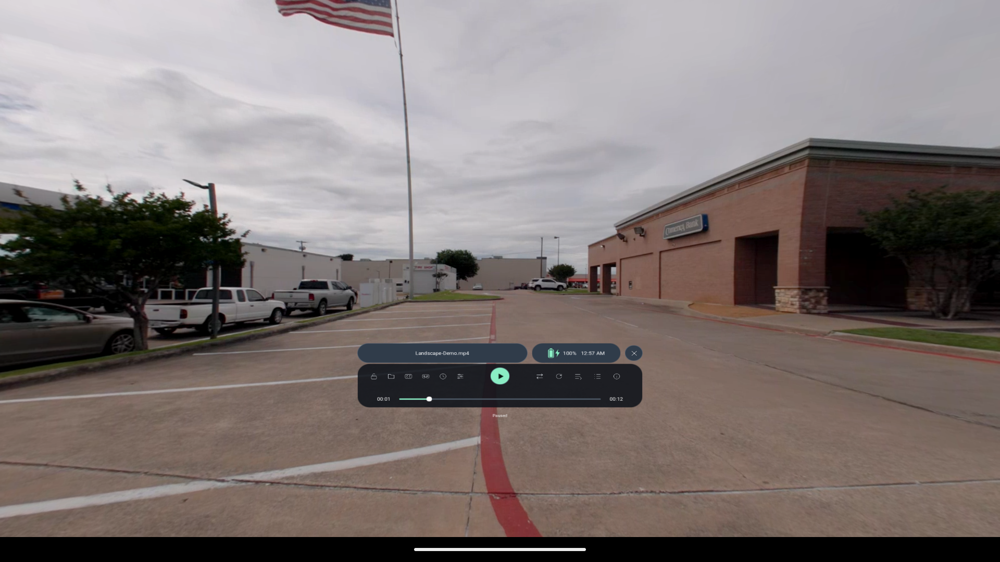
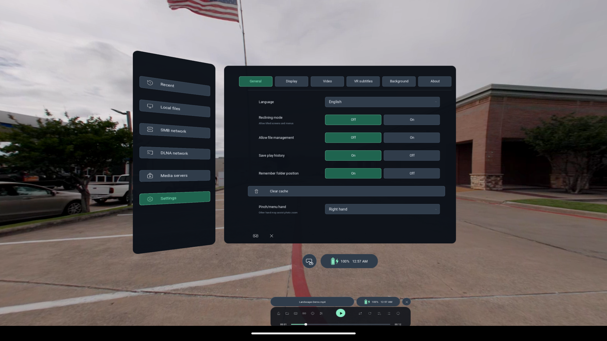
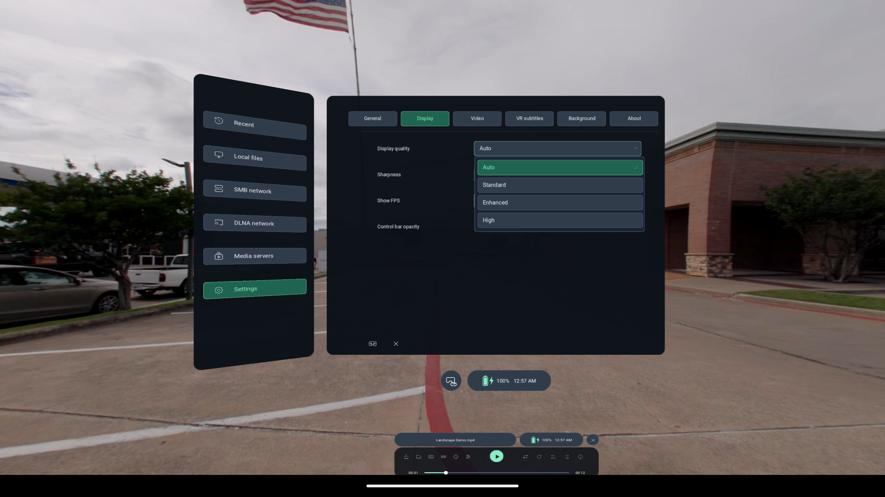

# Immivio

### Free, open-source VR video player for Meta Quest and PICO

**VR180 · VR360 · 3D Video**

## 产品简介 / Product overview

**一句话介绍：** 免费开源的 VR 视频播放器，把本地与网络视频带进私人影院。

**Short description:** A free, open-source VR player for local and network videos.

**中文**

Immivio 是一款面向 PICO 和 Meta Quest 的免费开源 VR 视频播放器，支持普通视频、3D 立体视频以及 180°／360°全景视频。你可以从本地文件、家庭共享文件夹或兼容的媒体服务器中选择影片，在虚拟大屏或环绕画面中观看。屏幕大小、位置和弯曲程度可按坐姿或躺姿调整，配合双语文字字幕、播放队列，以及可记忆的播放进度与观影偏好，让下一次继续观看更方便。播放器免费使用，无需购买或订阅。

**English**

Immivio is a free, open-source VR video player for PICO and Meta Quest. Watch regular, 3D stereo, 180° and 360° videos from local files, home shared folders or compatible media servers, on a virtual screen or in an immersive view. Adjust screen size, position and curvature for seated or reclined viewing. Bilingual text subtitles, playback queues and remembered progress and viewing preferences make it easier to pick up where you left off. The player requires no purchase or subscription.

[Website](https://northboundwisdom.github.io/immivio/) · [Releases](https://github.com/NorthBoundWisdom/immivio/releases) · [Development builds](https://github.com/NorthBoundWisdom/immivio/actions/workflows/android-release.yml) · [User guide](https://northboundwisdom.github.io/immivio/guide/) · [中文官网与使用指南](https://northboundwisdom.github.io/immivio/zh/)

Immivio continues development of [zerochocobo/Thru3D-Media-Player](https://github.com/zerochocobo/Thru3D-Media-Player). **Version 0.6.0 is the last shared baseline. From that point, this project follows its own development and release path, independently maintained by NorthBoundWisdom.** The original source history, attribution and GPL-3.0 license are preserved.

## Your media, all around you

*Actual Android 16 ARM64 emulator captures from a development build before the v0.9.5 tag. The supplied landscape sample is shown through the real renderer and 2D diagnostic entry; these images do not establish headset stereoscopy, passthrough or frame rate. The original video is not bundled. Capture provenance is recorded in [capture.json](website/assets/screenshots/capture.json).*

| Library and general settings | Display preferences |
| --- | --- |
|  |  |

- **Watch flat or immersive media.** Flat screens, VR180, VR360 and fisheye projections; side-by-side and top-bottom stereo layouts, including half-width/half-height formats.
- **Free and open source.** Download, use and build the player under GPL-3.0; third-party services follow their own terms and may have their own fees.
- **Bring your own library.** Local files and one Network media entry for SMB shares, DLNA libraries and supported media-server accounts. Saved and discovered sources appear together; adding a source lists sharing protocols and server providers side by side, with direct setup. Available operations depend on the source and your account permissions.
- **Get comfortable.** Move the picture and panels, adjust supported screen size/distance/curvature, and use reclining mode or head-follow when you want them.
- **Keep control.** Compact playback popups with slider resets, detected external-subtitle encodings and per-track overrides, filename filtering, playback speed, per-video timing, and a direct sequence/shuffle switch.
- **Read both languages.** Choose primary and secondary text captions with one shared delay and per-video memory, or place captions below a flat screen. Bitmap subtitles remain unsupported.
- **Return to familiar settings.** Remembered per-video track choices, stereo alignment and immersive adjustments; optional last-mode reuse, a 72 Hz display preference, and system-controlled volume. Emby/Jellyfin versions keep separate memories and report playback only with history enabled.
- **Choose your update channel.** The default appstore build has no update-check button. In web builds, Settings → About → Check for updates contacts GitHub only after a click and opens a newer release in the system browser; the app never downloads or installs an APK.
- **Open and diagnose.** Eligible Android VIEW/SEND videos use temporary access; redacted crash trails stay private until you confirm saving a log to Downloads. USB access uses verified system mounts; some PICO/provider paths remain unavailable.

Version 0.9.6 focuses on video-only libraries: a unified Network media entry, aligned browser padding, adjustable window height and continuous playback popups, including during small head movements. It adds appstore/web distribution channels and bilingual website privacy/terms pages. It retains v0.9.5's dual text captions and media-source improvements. See the [changelog](CHANGELOG.md) and [feature boundaries](docs/SELECTED_UPSTREAM_PORTS.md) for details and known limitations. Tagged APKs appear after the release build checks complete.

Immivio has **one playback edition**. It displays existing stereo/spatial content; it does not generate 3D from 2D. The earlier live AI depth, person-matting, model preparation and inference features have been removed.

## Download and install

Use [Releases](https://github.com/NorthBoundWisdom/immivio/releases) for published APKs. Current development packages are under a successful [Android workflow run](https://github.com/NorthBoundWisdom/immivio/actions/workflows/android-release.yml) → **Artifacts**; GitHub sign-in is required for those artifacts. Releases from before the rename retain their historical names and behavior.

Version 0.9.4 and later use the independent Android ID `com.northboundwisdom.immivio`. Its packages install separately from the legacy player; existing data is not automatically migrated.

Choose an APK matching your headset:

| Device | Artifact name |
| --- | --- |
| Meta Quest | `Immivio-QUEST-<version>-<debug-or-release>-<date>.apk` |
| PICO | `Immivio-PICO-<version>-<debug-or-release>-<date>.apk` |
| Compatible Android OpenXR runtime | `Immivio-OpenXR-<version>-<debug-or-release>-<date>.apk` — experimental |

1. Enable developer mode on your headset, connect it to your computer, and approve USB debugging.
2. Install the matching APK with your preferred sideloading tool. Source ZIP/TAR archives are not installable apps.
3. Launch **Immivio** from the headset's sideloaded-app library.
4. Open a local file or add a network source, granting only the access you want to use.
5. Match the projection and stereo layout to the file. For VR180 SBS fisheye content, choose **Fisheye + SBS**.

Quest 2 and PICO Neo3 are compatibility targets. Actual performance depends on headset, codec, bitrate and resolution. The generic OpenXR build needs a compatible Android runtime.

## Everyday controls

| Action | How |
| --- | --- |
| Show or hide playback controls | Left Menu button, or tap the picture with the trigger |
| Summon controls with the palm gesture | Left hand, independently of the pinch-hand preference; the right-hand system gesture stays reserved |
| Select a control | Controller ray + trigger; supported hand pointing/pinching also works |
| Move the picture or library window | Hold grip; use the same hand's thumbstick for distance where supported |
| Seek | Drag the timeline or use horizontal thumbstick shortcuts while lists/sliders are inactive |
| Adjust immersive video | Left grip + stick moves it horizontally/vertically; right grip + stick adjusts zoom or horizontal stereo alignment |
| Choose the primary pinch hand | **Settings → General → Pinch/menu hand**; new installs use Right; existing settings without a choice retain Both |
| Change volume | Use the headset’s system volume controls |
| Scroll a library or settings list | Use the thumbstick while the list is open |
| Return to the library | Choose **Close video** |
| Watch while reclined | **Settings → General → Reclining mode**; Follow is a separate setting |

Version 0.9.5 extends flat videos to 0.1–50 m / 5–3000% and menu distance to 4 m. Compatibility, readability and comfort still depend on the headset and media.

The interface supports English, Simplified Chinese, Traditional Chinese and Japanese. Text subtitles offer five color palettes and optional bilingual primary/secondary captions with a shared delay and per-video track memory. Flat video captions can also sit below the screen, with per-video layout memory. Color grading offers Original, Warm, Cool and Custom presets, with individual slider resets and a reset for the current popup page. Subtitle, timing, eye-alignment sliders also reset independently. See the [user guide](https://northboundwisdom.github.io/immivio/guide/) for sources, layouts, timing and queues.

## Useful answers

**What happened to AI / No AI editions?** Immivio is a single media player with no model-based conversion or person matting. Existing stereo video and native spatial formats are separate from those removed features.

**Will Immivio update my existing app?** The ordinary player's application ID and signing identity are retained to preserve its data. Android still requires matching signing keys; builds from other distributors or ephemeral CI keys may not update one another. Check the package notes before replacing an installation.

**Which subtitle and spatial formats are supported?** Text subtitle tracks and ordinary packed SBS/TB video are supported. Bitmap subtitles are not offered; MV-HEVC dual-view video and Dolby Vision colour correctness require separate device/media validation. See [playback libraries and formats](docs/BUILD.md#playback-libraries-and-formats).

**Will every 8K video play smoothly?** Codec, bitrate, projection and hardware all matter. An emulator screenshot is not a headset benchmark.

**Where do I report a problem?** Use [this repository's Issues](https://github.com/NorthBoundWisdom/immivio/issues). Include headset, build version, media format and reproduction steps. Share a sample only if you may distribute it; keep credentials and private media out of public reports.

## Project and development

- Store listing name: **Immivio – VR Video Player**
- [Changelog](CHANGELOG.md) · [Release notes / 更新说明](https://northboundwisdom.github.io/immivio/updates/)
- [Build from source](docs/BUILD.md) · [Architecture](docs/ARCHITECTURE.md) · [Refactor plan](docs/REFACTOR_PLAN.md) · [Testing](docs/TESTING.md) · [Refactor acceptance](docs/ACCEPTANCE.md) · [Contributing](CONTRIBUTING.md)
- Project source is [GPL-3.0-only](LICENSE). Third-party components retain their licenses. See [licensing details](docs/LICENSING.md).

[**Ravo Studio**](https://northboundwisdom.github.io/Ravo/) — organize, review and develop photographs.

[**SonaFolio**](https://northboundwisdom.github.io/sonafolio/) — turn podcasts and media into transcripts and a local knowledge library.
