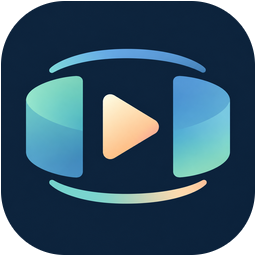
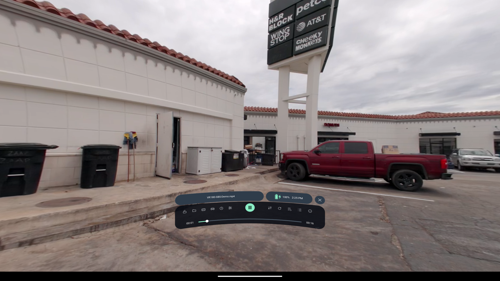
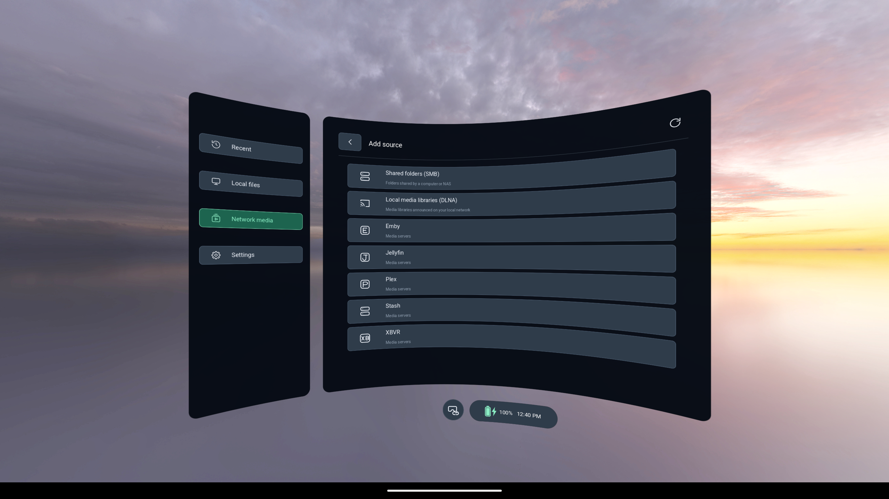
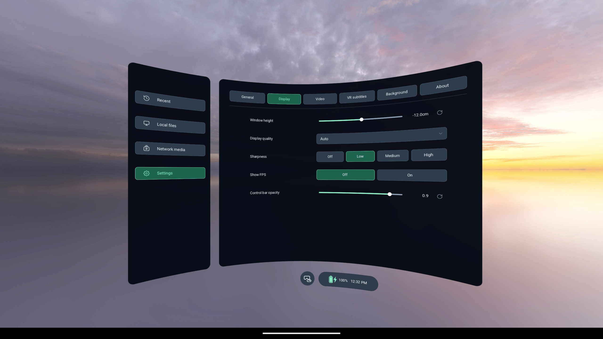
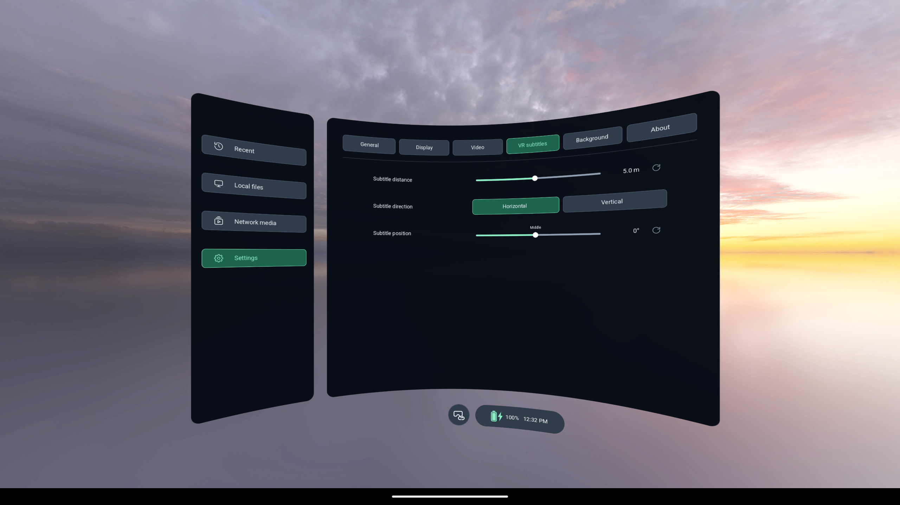

<h1 align="center">Immivio</h1>

  <b>Free, open-source VR video player for PICO and Meta Quest</b> 
  Flat · 3D stereo · VR180 · VR360

  <a href="https://northboundwisdom.github.io/immivio/">Website</a> ·
  <a href="https://northboundwisdom.github.io/immivio/zh/">中文官网</a> ·
  <a href="https://github.com/NorthBoundWisdom/immivio/releases">Download</a> ·
  <a href="https://northboundwisdom.github.io/immivio/guide/">User guide</a> ·
  <a href="https://northboundwisdom.github.io/immivio/zh/guide/">使用指南</a> ·
  <a href="CHANGELOG.md">Changelog</a>

**中文：** Immivio 是一款面向 PICO 和 Meta Quest 的免费开源 VR 视频播放器，支持普通视频、3D 立体视频以及 180°／360° 全景视频。影片可以来自本地文件、家庭共享文件夹或兼容的媒体服务器，在虚拟大屏或环绕画面中观看。屏幕大小、位置和弯曲程度可按坐姿或躺姿调整；双语字幕、播放队列以及按视频记住的进度和设置，让你下次可以直接接着看。免费使用，无需购买或订阅。

**English:** Immivio is a free, open-source VR video player for PICO and Meta Quest. Watch regular, 3D stereo, 180° and 360° videos from local files, home shared folders or compatible media servers, on a virtual screen or in an immersive view. Adjust screen size, position and curvature for seated or reclined viewing. Bilingual text subtitles, playback queues and per-video progress and settings let you pick up where you left off. No purchase or subscription is required.

## Screenshots

| Network media: add a source | Settings: display |
| --- | --- |
|  |  |

More: VR subtitle settings

*Uncropped captures of Immivio 0.9.6, taken on an Android 16 ARM64 emulator through the 2D diagnostic entry. They show the real interface but say nothing about headset stereo, passthrough or frame rate. The sample video is not included in this repository. For capture details, see [capture.json](branding/pico/details/capture.json).*

## Features

**Formats and projections**
- Flat, VR180, VR360 and fisheye projections.
- Side-by-side and top-bottom stereo, including half-width and half-height layouts.
- Immivio plays stereo and spatial content that already exists. It does not convert 2D video to 3D.

**Your video library**
- **Local files**, including USB drives mounted by the system. Supports STRM shortcuts and opening videos from Android's Open/Share menu.
- **Network media**, a single place for SMB shared folders, DLNA libraries, and Plex, Emby, Jellyfin, Stash and XBVR servers. What you can do depends on the source and your account permissions.
- File lists show only videos and folders, with list/icon views and remembered folder positions. During playback, Browse opens a compact video switcher above the controls. Close the video to return to the full library and Settings.

**Comfortable viewing**
- Start with a starry sky, or choose Sunset/Beach panoramas, cloud scenery, a dark background or passthrough. Adjust scenery direction and brightness.
- Move the picture and windows anywhere. Flat screens range from 0.1–50 m and 5–3000% size, with adjustable curvature and TV/cinema presets.
- Reclining mode and head-follow are available as separate settings, and the window height can be adjusted.
- Uses 72 Hz when the device supports it and lists only the refresh rates the device offers.

**Playback and subtitles**
- Automatically recognizes SBS/top-bottom video from naming, container metadata and matching eye images. Uncertain content stays in its current mode; saved manual choices take priority. Use **Video mode → Auto detect** to recheck a previously saved format. Image matching identifies stereo packing, while VR projection and lens angle still follow file markers or your settings.
- One compact control bar with popups for subtitles, speed, color, audio/subtitle timing, stereo alignment and the queue.
- Sequential or shuffled queues, which return to the library after the last video.
- SRT, ASS, SSA and VTT text subtitles, with automatic encoding detection and bilingual primary/secondary tracks. Captions can sit below a flat screen. Bitmap subtitles are not supported.
- Color grading presets: Original, Warm, Cool and Custom. Every slider has its own reset button.
- Track choices, stereo alignment, immersive adjustments and progress are remembered for each video.

**Privacy and updates**
- No account is needed. Playback history and per-video memory can be turned off.
- Crash logs stay on the device until you choose to save one to Downloads.
- Store builds have no update checker. Website builds check GitHub only when you click **Settings → About → Check for updates**, then open the release page in the browser. The app never downloads or installs an APK by itself.

**Languages:** English, Simplified Chinese, Traditional Chinese and Japanese.

## Download and install

Download published APKs from [Releases](https://github.com/NorthBoundWisdom/immivio/releases). Development builds are attached to successful [Android workflow runs](https://github.com/NorthBoundWisdom/immivio/actions/workflows/android-release.yml) under **Artifacts**. Downloading them requires a GitHub sign-in.

Pick the APK for your headset:

| Headset | APK |
| --- | --- |
| Meta Quest | `Immivio-QUEST-<version>-<channel>-<build>-<date>.apk` |
| PICO | `Immivio-PICO-<version>-<channel>-<build>-<date>.apk` |
| Other Android OpenXR runtimes (experimental) | `Immivio-OpenXR-<version>-<channel>-<build>-<date>.apk` |

`<channel>` is `web` for GitHub releases, which include the manual update check, or `appstore` for store builds. `<build>` is `release` or `debug`.

1. Turn on developer mode on the headset, connect it over USB and allow USB debugging.
2. Install the APK with any sideloading tool. Source ZIP/TAR archives are not apps.
3. Open **Immivio** from the headset's app library. On PICO, look under **Library → Unknown sources**.

Supported headsets include Quest 2 and PICO Neo3 and newer. Performance depends on the headset, codec, bitrate and resolution.

## Getting started

1. Open **Local files** or **Network media** and grant access only to the folders or servers you want to use.
2. Choose a video, then set the projection and stereo layout to match the file:

| Source | Setting |
| --- | --- |
| Ordinary video | Flat + mono |
| Side-by-side / top-bottom 3D | Flat + SBS / TB |
| VR180 SBS fisheye | Fisheye + SBS |
| 360° equirectangular | 360° + the source's mono/SBS/TB layout |

If the picture looks split, distorted or inverted, check the projection first, then the stereo layout, then swap eyes.

## Controls

| Action | How |
| --- | --- |
| Show or hide playback controls | Left Menu button, or tap the picture with the trigger. The left-palm gesture also works. |
| Select | Point the controller ray and press the trigger. Hand pointing and pinching are also supported. |
| Move the picture or a window | Hold grip. Use the same hand's thumbstick to change distance where supported. |
| Scroll a list | Thumbstick, while the list is open |
| Seek | Drag the timeline, or push the thumbstick left/right when no list or slider is active |
| Adjust immersive video | Left grip + stick to move it. Right grip + stick to zoom or adjust horizontal stereo alignment. |
| Recenter | Long-press the headset's Home button |
| Volume | The headset's system volume controls |
| Return to the library | **Close video** |
| Reclined viewing | **Settings → Display → Reclining mode** (Follow is a separate setting) |
| Pinch hand | **Settings → General → Pinch/menu hand** |

For sources, subtitles, timing and queues, see the [user guide](https://northboundwisdom.github.io/immivio/guide/).

## FAQ

**Will a new APK update my current installation?**
Only if both the application ID and the signing key match. Since 0.9.4 the ID has been `com.northboundwisdom.immivio`, which installs alongside the old Thru3D player (`com.wapok.thru3d`) without migrating its data. Builds from other distributors, and some CI builds, use different keys and cannot update each other.

**Will every 8K video play smoothly?**
Not necessarily. Codec, bitrate, projection and headset hardware all matter, and the screenshots above are not a performance benchmark.

**Are MV-HEVC or Dolby Vision supported?**
Neither has been validated yet. Ordinary packed SBS/TB stereo is supported. See [playback libraries and formats](docs/BUILD.md#playback-libraries-and-formats).

**Where do I report a problem?**
Open an issue in [Issues](https://github.com/NorthBoundWisdom/immivio/issues) with your headset, Immivio version, media format and the steps to reproduce it. Don't include credentials or private media.

## Development

- [Build from source](docs/BUILD.md): environment, build commands, PICO store packaging and signing
- [Architecture](docs/ARCHITECTURE.md) · [Testing](docs/TESTING.md) · [Acceptance](docs/ACCEPTANCE.md) · [Refactor plan](docs/REFACTOR_PLAN.md) · [Upstream ports](docs/SELECTED_UPSTREAM_PORTS.md)
- [Contributing](CONTRIBUTING.md)

## Origin and license

Immivio continues from [zerochocobo/Thru3D-Media-Player](https://github.com/zerochocobo/Thru3D-Media-Player). The last version the two projects share is 0.6.0. Since then NorthBoundWisdom has developed and released Immivio independently. The original history, attribution and license are preserved.

The project source is licensed under [GPL-3.0-only](LICENSE). Third-party components keep their own licenses; see [licensing details](docs/LICENSING.md). Third-party media services follow their own terms and may charge fees.

## More from NorthBoundWisdom

- [**SonaFolio**](https://northboundwisdom.github.io/sonafolio/): turns podcasts and media into transcripts and a local knowledge library.
